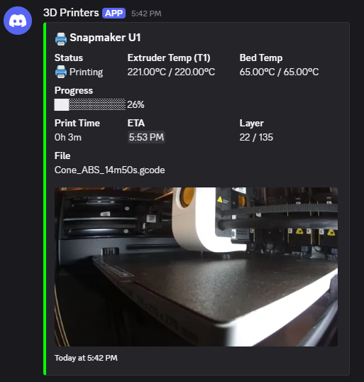

# U1_notify

Print notifications for the **Snapmaker U1** running [paxx12's Extended Firmware](https://github.com/paxx12-snapmaker-u1/SnapmakerU1-Extended-Firmware), sent to Telegram, Discord, Matrix, ntfy, e-mail or any of the [100+ services Apprise supports](https://github.com/caronc/apprise/wiki), with a camera photo attached.

It's a port of ghzserg's [notify plugin for Zmod](https://github.com/ghzserg/notify) (Flashforge AD5X/AD5M), by way of [FLSUN_notify](https://github.com/DIEHARDave/FLSUN_notify). The macros, switches and settings file work the same way, so Zmod's instructions apply here too. It uses the notifier and Apprise already built into the Extended Firmware's Moonraker, so it doesn't need an external server or bot.

## What you get

| Notification | Sent by | Turn it off |
| :--- | :--- | :--- |
| Print started, finished, error, cancelled, paused, resumed | Moonraker | `u1_notify_custom.cfg`, see [Settings](#settings) |
| Printer turned on | U1_notify | `SAVE_VARIABLE VARIABLE=notify_on VALUE=0` |
| Filament runout (active toolhead) | U1_notify | `SAVE_VARIABLE VARIABLE=notify_filament VALUE=0` |
| Progress every N percent (off by default) | U1_notify | `SAVE_VARIABLE VARIABLE=notify_percent VALUE=0` |
| Your own messages from G-code (`_NOTIFY`) | U1_notify | – |

Each message starts with your printer's name and includes a snapshot from the U1's internal camera, unless you turn photos off. With a Discord webhook you get [Discord cards](#discord) instead of plain text.

## Before you install: system persistence

The U1 resets everything outside `/home/lava/printer_data` at every boot. U1_notify keeps its files and settings there, but the small Moonraker component that sends the progress, runout and "Printer on" messages and the Discord cards has to sit inside Moonraker itself. So the installer turns on the Extended Firmware's [system persistence](https://github.com/paxx12-snapmaker-u1/SnapmakerU1-Extended-Firmware/blob/develop/docs/data_persistence.md) by creating `/oem/.debug`.

**A firmware upgrade turns persistence off and removes the component.** After each upgrade, run the installer again (see [After a firmware upgrade](#after-a-firmware-upgrade)). Until you do, the start, finish, error, cancel, pause and resume messages still arrive as plain text, and Moonraker shows a warning that the `u1_notify` component can't be loaded.

## Install

1. Turn on SSH: on the printer, **Settings > Maintenance > Root Access**, accept and **Open** (or `ssh: true` under `[remote_access]` in `extended2.cfg`).
2. SSH in as `root` (password `snapmaker`) and run this while the printer is idle:

   ```sh
   curl -fsSL https://raw.githubusercontent.com/DIEHARDave/U1_notify/main/install.sh | bash
   ```

The installer restarts Klipper and Moonraker. It is safe to run again.

### Coming from a hand-made notify setup

If you set up Zmod's notify files by hand (`notify.cfg` in `extended/klipper/`, `notify.moonraker.cfg` in `extended/moonraker/`, a `user_variables.cfg` with `notify_percent`), the installer moves them to `/home/lava/printer_data/backup/u1_notify/` and removes them, so they can't clash with U1_notify. It keeps your URL and name from `moonraker.secrets` and your `notify_percent` step. A file that mixes notify sections with other settings is left alone with a warning; take the notify parts out yourself.

## Set up

1. In Mainsail or Fluidd, open the configuration files and edit `u1_notify.txt`:

   ```ini
   [notify]
   url: tgram://{bottoken}/{ChatID}
   name: {printer_name}
   ```

   Replace `url` with your service's [Apprise URL](https://github.com/caronc/apprise/wiki) and `name` with your printer's name. Don't remove the `url:` line.

2. Save, then run `UPDATE_NOTIFY` in the console. Moonraker restarts, and after about 20 seconds you should get the message "Notifications are set up". Saving the file alone changes nothing; until you run `UPDATE_NOTIFY`, the console reminds you that the changes aren't in use.

3. To send a test message at any time, run `_NOTIFY MSG=Test` in the console.

Moonraker keeps the URL in `/home/lava/printer_data/moonraker.secrets`, which Mainsail and Fluidd can't show. `u1_notify.txt` is the copy you edit; `UPDATE_NOTIFY` copies it over.

### Telegram

1. Message [@BotFather](https://t.me/BotFather), send `/newbot`, pick any name, then a username ending in `_bot`.
2. BotFather replies with a token like `1234567890:AAAAAAAABBBBBBBBBBCCCCCCCDDDEEEEEEE`. Put it in place of `{bottoken}`.
3. **Find your new bot in Telegram and send it any message**; it can't message you until you do.
4. Message [@userinfobot](https://t.me/userinfobot) and send `/start`. It replies with your ID, like `123456789`. Put it in place of `{ChatID}`.

The finished file looks like this:

```ini
[notify]
url: tgram://1234567890:AAAAAAAABBBBBBBBBBCCCCCCCDDDEEEEEEE/123456789
name: My U1
```

### Discord

In your Discord server, open the channel's settings → Integrations → Webhooks → New Webhook, then **Copy Webhook URL** and paste it as `url` unchanged:

```ini
[notify]
url: https://discord.com/api/webhooks/123456789012345678/abcdefghijklmnopqrstuvwxyz
name: My U1
```

With a Discord webhook, U1_notify sends Discord embeds laid out like [FlashForgeUI](https://github.com/Parallel-7/FlashForgeUI-Electron)'s instead of plain text: a colored card with the status, the active toolhead's nozzle temperature and the bed temperature, and while printing a progress bar, print time, ETA, layer and file name, with the camera photo inside the card. A finished print gets a "✅ Print Complete!" card with the total time. Your own `_NOTIFY` text, a runout warning or "Printer on" appears at the top of the card.



The layer comes from the slicer (OrcaSlicer's U1 profile sends `SET_PRINT_STATS_INFO`) or, failing that, from the nozzle height. The ETA uses the slicer's time estimate and shows in each reader's own time zone. If Discord rejects an embed, the message is sent as plain text instead. To always get plain text, add this to `u1_notify_custom.cfg` and restart Moonraker:

```ini
[u1_notify]
discord_embeds: False
```

The `body:` text of Moonraker's notifiers isn't used for embeds, so changes to it in `u1_notify_custom.cfg` only show up with `discord_embeds: False` or on other services.

### Other services

For other services (Matrix, ntfy, Pushover, e-mail and more), see the [Apprise URL list](https://github.com/caronc/apprise/wiki). The [Zmod notify README](https://github.com/ghzserg/notify#matrix-setup-example) has a worked Matrix example.

## Settings

### Switches

Set these in the console. They're stored in Klipper's saved variables (`variables.cfg`), so they survive a reboot.

| Command | Effect |
| :--- | :--- |
| `SAVE_VARIABLE VARIABLE=notify_percent VALUE=5` | Progress message every 5% (any whole number from 1 to 99; 0 turns it off) |
| `SAVE_VARIABLE VARIABLE=notify_photo VALUE=0` | No photos on U1_notify's messages (1 turns them back on) |
| `SAVE_VARIABLE VARIABLE=notify_on VALUE=0` | No "Printer on" message |
| `SAVE_VARIABLE VARIABLE=notify_filament VALUE=0` | No filament runout message |

Progress messages look like `benchy.gcode (25%) | T0 219.8/220.0°C | 60.1/60.0°C` (active toolhead, then bed: current/target).

The U1's Klipper config has no `[save_variables]` section, so the installer adds one that stores the variables in `config/variables.cfg`. If you already have your own `[save_variables]`, the installer uses that instead.

### Moonraker's print notifications

The start, finish, error, cancel, pause and resume messages come from Moonraker. To change or turn one off, add a section to `extended/moonraker/u1_notify_custom.cfg`, then restart Moonraker:

```ini
[notifier print_start]
events: none
```

The names are `print_start`, `print_complete`, `print_error`, `print_cancelled`, `print_paused` and `print_resumed`. To send one without a photo, add an empty `attach:` line instead. The installer creates this file once and never overwrites it.

The photo comes from `http://127.0.0.1/webcam/snapshot.jpg`, which needs the internal camera set to `paxx12` (the default) in `extended2.cfg`. With the camera off or set to `snapmaker`, add an empty `attach:` to each notifier, including `notifier_photo`.

## Use in G-code

`_NOTIFY` sends a message from a macro or from your slicer's G-code:

```
_NOTIFY MSG="Bed is hot, starting" PHOTO=0
```

- `MSG`: the text to send.
- `PHOTO`: `1` attaches a camera snapshot (default), `0` doesn't.
- `TYPE` (optional): a name for a switch. `TYPE=door` is skipped while `notify_door` is 0, so you can mute your own message types the same way as the built-in ones.

## How it differs from Zmod's plugin

- Zmod calls the notification macros from its own print and sensor macros. Snapmaker's macros don't, so a small Moonraker component (`u1_notify`) watches Klipper's status and sends the progress, filament runout and "Printer on" messages itself, with the same switches. Snapmaker's `printer.cfg` isn't changed; everything goes in through the Extended Firmware's `extended/` folders.
- Filament runout watches the motion sensor of the toolhead that's printing. Snapmaker's firmware also pauses the print, so you get a pause message as well.
- "Printer on" is sent when Klipper becomes ready within 5 minutes of a boot, so restarting Klipper or Moonraker later doesn't send it.
- Zmod sends "The printer has finished printing" from `END_PRINT` (switch `notify_end`). Here Moonraker's own finished message covers it.
- Zmod's `UPDATE_NOTIFY` reboots the printer. Here the component only restarts Moonraker.
- Messages are in English only for now.

## Files

| Path (under `/home/lava/printer_data`) | What it is |
| :--- | :--- |
| `U1_notify/` | The plugin itself. Replaced on update. |
| `config/u1_notify.txt` | Your URL and printer name. Kept on uninstall. |
| `config/extended/moonraker/u1_notify_custom.cfg` | Your Moonraker overrides. |
| `config/extended/moonraker/u1_notify.cfg` | Link to the Moonraker notifiers. |
| `config/extended/klipper/u1_notify.cfg` | Link to the Klipper macros. |
| `config/extended/klipper/u1_notify_variables.cfg` | Link to the `[save_variables]` section, if you had none. |
| `config/variables.cfg` | Klipper's saved variables, including the `notify_*` switches. |
| `moonraker.secrets` | Moonraker's copy of the URL and name, written by `UPDATE_NOTIFY`. |

The component is linked from `/home/lava/moonraker/moonraker/components/u1_notify.py`, which lasts only while persistence is on.

## Update

Run the install command again; it downloads the latest version and keeps your settings:

```sh
curl -fsSL https://raw.githubusercontent.com/DIEHARDave/U1_notify/main/install.sh | bash
```

## After a firmware upgrade

The upgrade removes `/oem/.debug` and the component link. SSH in as `root` and run:

```sh
bash /home/lava/printer_data/U1_notify/install.sh
```

## Uninstall

```sh
bash /home/lava/printer_data/U1_notify/uninstall.sh
```

The uninstaller keeps `u1_notify.txt` and `variables.cfg`. It leaves system persistence on, since other changes may rely on it; to turn it off, run `rm /oem/.debug` and reboot.

## Credits

Based on [notify](https://github.com/ghzserg/notify) by ghzserg (Sergei Rozhkov), part of [Zmod](https://github.com/ghzserg/zmod). Notifications are sent by [Moonraker](https://github.com/Arksine/moonraker)'s notifier and [Apprise](https://github.com/caronc/apprise). Built for [paxx12's Snapmaker U1 Extended Firmware](https://github.com/paxx12-snapmaker-u1/SnapmakerU1-Extended-Firmware). Licensed under the GNU GPLv3, the same as the original.
